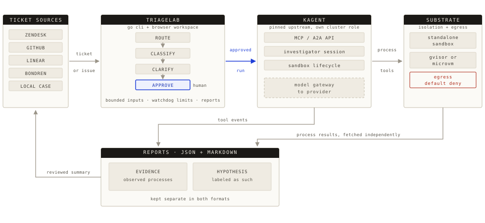

<picture>
  <source media="(prefers-color-scheme: dark)" srcset="docs-site/src/assets/triagelab-mark-dark.svg">
  
</picture>

# TriageLab

**[Documentation](https://bondrenai.github.io/TriageLab/)** ·
[Quickstart](#quickstart) ·
[CLI reference](https://bondrenai.github.io/TriageLab/reference/cli/)

TriageLab investigates technical issues by trying to reproduce them. You give
it a problem description and a few files, such as a small repository, logs, or
configuration. An AI investigator then runs experiments in a disposable,
isolated sandbox on Kubernetes. TriageLab records every process the
investigator ran, with its exit status and output, and saves that evidence in
a JSON and Markdown report, kept apart from the model's conclusions.

Cases can come from the command line, a browser workspace, or a ticket in
Zendesk, GitHub, Linear, Bondren, or Jira. For a ticket, TriageLab matches it to a
procedure, drafts a request for any missing evidence, and waits for your
approval before starting. You can let a procedure start on its own once its
evidence is ready. When the investigation ends, you can send a reviewed
summary back to the ticket. Other programs can start investigations through
the CLI, an HTTP MCP endpoint, or OAuth API clients.

TriageLab is free and Apache 2.0 licensed. It is an early, single-user pilot:
it runs against a dedicated development cluster, and every ticket source
currently uses one built-in procedure for a Python 3.12 timeout example.

## How it works



Every run follows the same steps, whether it starts from the CLI, the
workspace, or a ticket:

1. TriageLab checks and bounds the inputs, creates one sandbox, and copies the
   files into it.
2. A kagent investigator chooses experiments and runs them in the sandbox
   with kagent's process and file tools. Outbound network access is denied by
   default.
3. TriageLab fetches each process's status, stdout, and stderr itself. The
   model's claims must cite those process IDs.
4. TriageLab writes the report and deletes the sandbox. If the investigator
   needs more information, TriageLab pauses the sandbox instead so the
   investigation can resume later.

The report keeps failed experiments as well as successful ones. It presents
the model's explanation of the cause as a hypothesis; it does not certify a
root cause.

Three projects share the work:

- **TriageLab**: ticket routing, clarification policy, run admission, input
  limits, investigation budgets, evidence validation, cleanup, and reports.
- **[kagent](https://github.com/kagent-dev/kagent)**: the agent loop, model
  access, tools, sessions, and sandbox lifecycle.
- **Agent Substrate**: isolated execution under gVisor or a microVM, resource
  allocation, snapshots, identity, and egress enforcement.

TriageLab adds no operator, agent framework, or database. See
[architecture](docs/architecture.md) for details.

## Quickstart

The quickstart installs kagent and Agent Substrate in a kind cluster on a
Linux VM, then runs the included example investigation. Run every command on
the VM; your laptop only needs SSH.

There is no offline or simulated mode. The example calls a real model and runs
in a real sandbox, and your model provider bills for the calls.

### 1. Prepare a VM

Use a dedicated, disposable Linux VM. Start with 4 vCPUs, 16 GiB of RAM, and
about 30 GiB of free disk. Install:

- Docker, Git, kubectl, Helm 3, and kind 0.33.0
- Go 1.27.4

You also need an OpenAI API key. The example investigator uses `gpt-6.1-sol`
through the Responses API.

Never install this setup into a production or shared cluster. Its kagent
authentication is for private development only.

### 2. Get the code and the kagent CLI

Clone the repository, then download and verify kagent CLI 1.0.0. This example
is for Linux amd64; for other architectures, see
[development setup](docs/development.md).

```bash
git clone https://github.com/bondrenai/TriageLab.git
cd TriageLab
mkdir -p .tools
curl -fL https://github.com/kagent-dev/kagent/releases/download/v1.0.0/kagent-linux-amd64 \
  -o .tools/kagent
echo 'c1a0a37767c4c2526e6d42b7016cfc11e69e82e321f6b84c1499d539d0dd864d  .tools/kagent' \
  | sha256sum -c -
chmod +x .tools/kagent
export PATH="$PWD/.tools:$PATH"
```

### 3. Create the cluster and install the stack

Create the cluster:

```bash
kind create cluster --name triagelab --image kindest/node:v1.35.0 \
  --config deploy/kind.yaml --wait 120s
```

Enter your OpenAI API key at the hidden prompt, then run the installer and
build the CLI:

```bash
read -rs OPENAI_API_KEY && export OPENAI_API_KEY
bash scripts/install-dev.sh
unset OPENAI_API_KEY
make build
```

The installer changes only the `kind-triagelab` cluster. It:

- installs Agent Substrate and kagent 1.0.0, and gives the API key to kagent;
- swaps in TriageLab's pinned kagent controller, built from source, which
  keeps paused investigations from being deleted;
- applies TriageLab's agent and sandbox template and waits until both are
  ready.

It stops without changing anything if the cluster already has a kagent
controller.

### 4. Connect to kagent

The CLI reaches the kagent controller through a port forward. Start it in its
own terminal and leave it running:

```bash
kubectl --context kind-triagelab -n kagent port-forward \
  --address 127.0.0.1 svc/kagent-controller 8083:8083
```

### 5. Run the example

In a second terminal, from the repository root, create a one-hour access token
and check the connection:

```bash
export TRIAGELAB_TOKEN="$(kubectl --context kind-triagelab -n kagent \
  create token triagelab --audience=kagent-invocation --duration=1h)"
./bin/triagelab doctor
```

`doctor` reports whether the kagent sandbox API is reachable. Then run the
example:

```bash
./bin/triagelab investigate \
  --description-file examples/config-bug/issue.md --repo examples/config-bug
```

The example is a small Python client whose request timeout is set in the wrong
unit: the intended five seconds is configured as five milliseconds. A good
investigation reproduces the failure, finds the unit mismatch, and
verifies an exact corrected value. The CLI prints where it saved the report;
[the example investigation](https://bondrenai.github.io/TriageLab/start/example/)
explains how to read it.

Keep the token out of logs and shell output, and create a new one when it
expires. Without `--config`, the CLI uses the same settings as
`triagelab.example.json`. To change the endpoint, time limits, or experiment
budget, copy that file and pass `--config`.

That example is the first of six evaluation cases in `examples/`. The others
cover a report that does not reproduce, missing information, an unrelated
nonzero exit, a deterministic failure that looks intermittent, and
prompt-injection bait beside a real bug. Expected results live in
`examples/corpus.json`, outside the uploaded case directories.
`make test-integration` scores a live run of every case, or the subset named in
`TRIAGELAB_CASES`. Only the timeout example has run against a model so far;
see [verification](docs/verification.md#evaluation-corpus-authored-not-run-live).

### 6. Tear down


Copy any reports you want to keep off the VM, then delete the cluster:

```bash
kind delete cluster --name triagelab
```

Delete the VM and its disk the same way you created them. A stopped VM still
incurs storage charges.

[Development setup](docs/development.md) covers each step in more depth,
including troubleshooting, reviewing the generated resources before applying
them, and the optional microVM backend.

## Investigate your own case

```bash
./bin/triagelab investigate --description 'The service rejects valid requests' \
  --repo ./small-reproduction --log ./service.log --file ./config-example.json
```

`--log` and `--file` can be repeated. TriageLab copies the inputs into
`/data/workspace` in the sandbox; nothing is mounted from the host. The limits
are 64 files, 1 MiB per file, and 4 MiB in total. Symlinks, special files,
path traversal, and common credential files and contents are rejected. Links
in the path leading to an input, such as macOS `/tmp`, are followed.

Everything you submit goes to the model provider. Keep repositories small,
and review support data before sending it: secret detection catches only
obvious cases.

The default sandbox has Python 3.12 and standard Linux tools, and no network
access. For a case that needs other dependencies, render the resources with a
different digest-pinned tools image; see
[development setup](docs/development.md).

### Reports and exit codes

Each run writes `reports/<case-id>/report.json`, the canonical record, and
`report.md`, a readable version of it. Both are written even when a run fails
partway. Treat them as private: they contain your inputs and the sandbox
output.

| Exit code | Meaning |
| --- | --- |
| `0` | Reproduced, paused, or closed |
| `1` | Not reproduced |
| `2` | Invalid input |
| `3` | Inconclusive |
| `4` | Infrastructure, agent, or protocol failure |
| `5` | Cleanup incomplete |
| `124` | Time limit reached |
| `130` | Interrupted |

A nonzero exit code never means you should discard the report, and an
infrastructure failure is never reported as "not reproduced".

Ctrl-C or SIGTERM cancels the run and deletes the sandbox. If the CLI crashes
or loses its connection, the sandbox's server-side time limit removes it. If
cleanup fails, the CLI exits with `5` and the report keeps the IDs needed to
finish:

```bash
./bin/triagelab cleanup --report reports/<case-id>/report.json
```

### Pause and resume

When the investigator needs more information, TriageLab saves the evidence so
far and suspends the sandbox. You can also pause a run yourself. A paused
investigation keeps its sandbox and conversation until you resume or close it,
even across TriageLab restarts and weeks of waiting:

```bash
./bin/triagelab pause --report reports/<case-id>/report.json
./bin/triagelab resume --report reports/<case-id>/report.json \
  --description 'The customer supplied these additional details' --log ./new-evidence.log
./bin/triagelab close --report reports/<case-id>/report.json
```

- Wait until the report shows `paused` before you stop TriageLab.
- Each resume starts a new bounded round with the original agent, tools, and
  limits. Earlier rounds stay under `rounds/`.
- Keep the whole run directory, including `lifecycle.json`.
- Resume with a fresh token for the same endpoint and identity.

Paused sandboxes never expire on their own. They depend on the pinned
controller, on `config.sessions.idleTtl: 0s` (the installer sets both), and on
kagent's database and snapshot storage staying available. Files in durable
workspace directories survive a pause; process memory, running commands, and
edits elsewhere do not. See [durable investigations](docs/durable-investigations.md).

## Browser workspace

The workspace is a web UI for the same workflow. You can submit a case, follow
it live, cancel it, inspect process evidence, and download reports. It lists
every report in `reports/`, including CLI runs. It also shows a labelled
example from a previously recorded investigation; viewing it starts no model
or sandbox.

Build the UI on the VM (Node.js 24 is required) and create the first account.
The server won't start without one. Type the password at the hidden prompt:

```bash
make install-ui build-ui build
read -rs pw && printf '%s' "$pw" | ./bin/triagelab user add --username admin --role admin --password-stdin; unset pw
```

With the port forward from step 4 running and `TRIAGELAB_TOKEN` set in the
same shell, start the server:

```bash
./bin/triagelab serve
```

The server listens only on `127.0.0.1:8080` and runs one investigation at a
time. From your laptop, open an SSH tunnel to the VM, then browse to
<http://127.0.0.1:8080>:

```bash
ssh -N -L 8080:127.0.0.1:8080 YOUR_VM
```

Keep the tunnel private. From the workspace you can also:

- **Manage access.** Sign in with local accounts or one OpenID Connect
  provider, with viewer, user, and admin roles. Admins can register OAuth API
  clients, so other applications can start investigations and read results
  with a scoped token. See
  [sign-in and roles](https://bondrenai.github.io/TriageLab/guides/sign-in/)
  and [API clients](https://bondrenai.github.io/TriageLab/guides/api-clients/).
- **Define agents.** The **Agents** page and `triagelab agent-manifest` produce
  native kagent definitions for other investigators: choose a provider and
  model, attach MCP tools, and pick the agent for a manual run. See
  [defining agents](docs/agents.md).
- **Ask about results.** Optional results chat answers questions about a
  finished investigation's evidence. An optional HTTP MCP endpoint lets MCP
  clients read, start, and pause investigations. See
  [results chat and MCP](https://bondrenai.github.io/TriageLab/guides/chat-mcp/).

For UI development, run `make dev-ui` next to the Go server; Vite proxies
`/api` to it. See [UI development](docs/ui.md).

### Tickets

An admin connects ticket sources on the workspace's **Connections** page, or
seeds them at startup with `serve --tickets <config>`. Credentials stay on the
server. Each source has an example configuration in the repository root and a
guide:

- [Zendesk](docs/tickets.md): clarifications are public replies, and
  investigation summaries are private notes.
- [GitHub issues](docs/github-issues.md), for one repository: comments are
  visible to anyone with repository access, and public in a public repository.
- [Linear](docs/linear-issues.md), for one team: comments are visible to
  everyone in the Linear workspace.
- [Bondren](docs/bondren-issues.md), for one workspace: clarifications are
  public messages to the requester, and investigation summaries are internal
  notes visible only to the team.
- [Jira Cloud](docs/jira-issues.md), for one site: clarifications are
  customer-visible replies on Jira Service Management issues, and
  investigation summaries are internal comments.

Each connection matches cases to procedures. A procedure sets the evidence it
needs, the clarification to send, and the agent and sandbox to use.
TriageLab binds each launch to the exact evidence and run settings it checked.
Launches wait for approval unless you
[enable automatic investigations](https://bondrenai.github.io/TriageLab/guides/workspace/#automatic-ticket-investigations)
for a procedure. Every source starts with the built-in Python 3.12 timeout
procedure; admins can add others under **Ticket cases → Edit procedures**.

## Deploy with Helm

The workspace can also run as a single pod beside an existing kagent and
Substrate installation, from the public chart
`oci://ghcr.io/bondrenai/charts/triagelab`. The access model is unchanged: the
UI listens on loopback inside the pod, and you reach it with
`kubectl port-forward`. The chart deliberately creates no Service or Ingress.
See [Helm deployment](docs/helm.md).

## Development

Run checks on the development VM, not your laptop:

```bash
make fmt
make check                    # gofmt check, go vet, unit and HTTP protocol tests
make race                     # the same tests under the race detector (several minutes)
make lint                     # staticcheck, pinned via go run (see staticcheck.conf)
make vulncheck                # govulncheck, pinned via go run
make build                    # VERSION defaults to git describe, else "dev"
make dist                     # static linux/darwin amd64/arm64 binaries + SHA256SUMS in dist/
make check-ui                 # TypeScript check (after make install-ui)
make build-ui                 # production browser assets
TRIAGELAB_CONFIG=triagelab.example.json make test-integration
make test-sandbox-integration # sandbox upload, egress denial, kill, delete; no model
```

CI runs `make check` on Ubuntu and macOS, and `make lint` and `make vulncheck`
on Ubuntu. A `v*` tag release repeats those checks, then publishes the
multi-arch image, the chart, and static CLI binaries with checksums (the
binaries do not include the web UI that `serve` needs); see
[Helm deployment](docs/helm.md#publishing-maintainers).

The integration test is opt-in and needs the real deployment and a model
credential; it never falls back to a mock. The sandbox test is also opt-in and
needs the deployment but no model. A scheduled
[live verification workflow](docs/development.md#scheduled-live-verification)
runs both on a disposable cluster. Unit tests use test HTTP servers
and fixture backends to cover failure paths, but they don't demonstrate the
full system. [Verification](docs/verification.md) records what has actually
been run against the real stack.

The Go code follows a conventional layout: a `cmd/triagelab` entry point,
`internal/` packages, the standard `flag` and `net/http` packages, and a few
vendored dependencies. Optional OpenTelemetry export sends traces, metrics,
and logs over OTLP/HTTP when you pass `--telemetry`; see
`triagelab.telemetry.example.json`.

The public documentation in `docs-site/` (Astro and Starlight) is published
to GitHub Pages on every push to main. `triagelab docs` generates its CLI and
configuration reference from the real flag registrations and config structs.
A golden test in `make check` fails if they drift, and the site build checks
internal links. See `docs-site/README.md`. Notes for contributors stay in
`docs/`; start with [CONTRIBUTING.md](CONTRIBUTING.md).

## Security and limitations

- **Private development only.** kagent's pinned development authentication is
  not an internet-facing security boundary. Keep the controller private and
  use a dedicated cluster and identity. Read [SECURITY.md](SECURITY.md).
- **Prompt injection.** Imported content is always untrusted. Prompt rules and
  post-run tool auditing can't guarantee that a model resists prompt
  injection. The hard boundaries are sandbox isolation, egress rules, resource
  limits, and keeping credentials out of sandboxes.
- **Best-effort redaction.** Secret detection catches obvious cases only.
  Review support data before it reaches a model provider.
- **Network access.** Sandbox egress is denied by default. Operators can add
  explicit EgressPolicy references or other digest-pinned templates, through
  reviewed manifests or the workspace's **Sandboxes** and **Egress** editors.
  Choosing a template per run requires `serve --allow-resource-writes`.
- **Isolation backend.** The default setup uses gVisor. MicroVM isolation
  needs KVM and a suitable WorkerPool.
- **Alpha upstream APIs.** The pinned Kubernetes interfaces are still
  `v1alpha3`. Read [upstream contracts](docs/upstream.md) before upgrading
  kagent or Substrate.

[Documentation](https://bondrenai.github.io/TriageLab/) · [Architecture](docs/architecture.md) · [Roadmap](TODO.md) ·
[Contributing](CONTRIBUTING.md) · [Apache 2.0 license](LICENSE)
